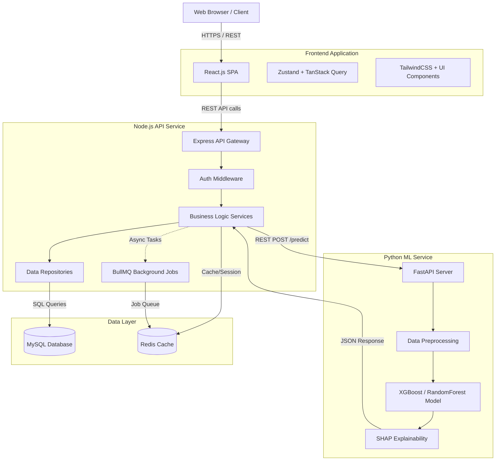

# System Architecture

The AI Placement Readiness & Skill Gap Recommendation Platform follows a modern, scalable microservices-inspired architecture, divided into clear functional tiers.

## High-Level Architecture

## Component Breakdown

1. **Frontend Tier (Client)**: A React.js Single Page Application (SPA) providing role-based dashboards (Student, Mentor, Admin). Communicates via REST APIs.
2. **Backend API Tier (Node.js)**: The central hub for the application. Handles authentication, business logic, CRUD operations, database connections, and orchestrates calls to the ML service.
3. **Machine Learning Tier (Python)**: A dedicated Python FastAPI service that loads pre-trained models, processes student data, generates readiness predictions, and uses SHAP to provide feature importance (explainability).
4. **Data Tier (MySQL + Redis)**: MySQL serves as the primary relational database holding all application data. Redis is used for caching, session management, and as a message broker for background jobs.
