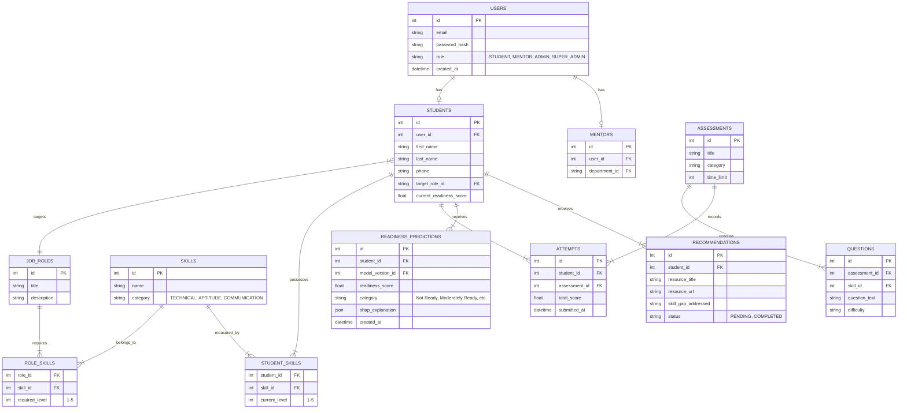

# Database Architecture

The platform uses a relational database (MySQL) to ensure data integrity and complex querying capabilities.

## Entity Relationship Diagram (ERD)

## Key Design Principles
- **Normalization**: Tables are normalized to 3NF to avoid data redundancy.
- **Role-Based Users**: A single `users` table handles authentication, while role-specific details are in `students`, `mentors`, etc.
- **Historical Tracking**: Predictions, assessments, and recommendations are timestamped to track progress over time.
- **JSON Storage**: SHAP explanations from the ML model are stored as JSON in the database for flexibility since feature importance varies per prediction.
